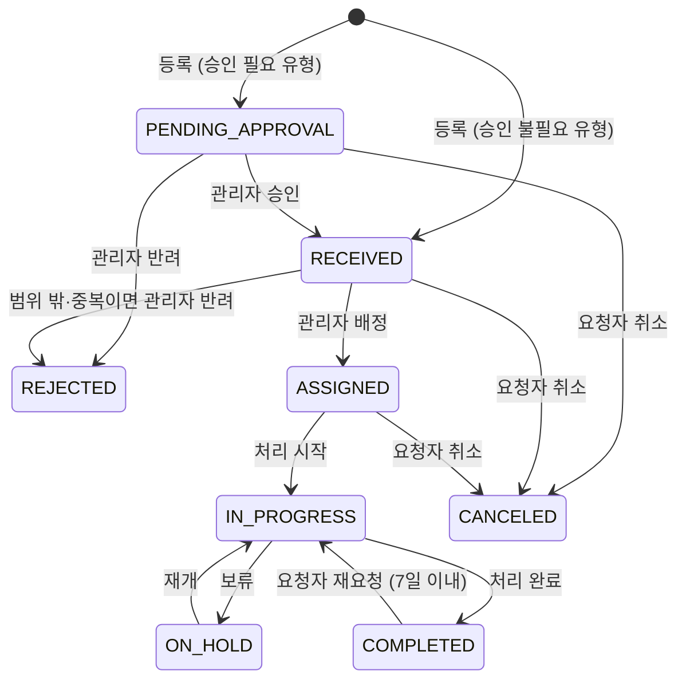

# 업무요청 관리 시스템 기획·화면설계

Nov 9, 2026 · @Jaewan

## 개요

현업 부서가 전산팀에 보내는 업무 요청(프로그램 수정, 권한 요청, 장애 신고, 데이터 추출)을 접수하고 처리 상황을 관리하는 사내 시스템입니다. 대학·병원 전산실이 매일 쓰는 업무를 그대로 옮겨, 지원할 조직의 실제 업무를 이해하고 있다는 근거로 씁니다.

| 항목 | 내용 |
| --- | --- |
| 기간 | 약 5주 목표 (Java 기초 1주 + 개발 4주). 공부하며 진행하므로 학습 속도에 맞춰 조정 |
| 서버 | Java 21, Spring Boot 4.1 (Spring Security 7), Spring Data JPA, MyBatis |
| DB | MySQL (데이터 변경은 JPA, 목록 검색과 통계 조회는 MyBatis로 SQL 직접 작성) |
| 화면 | React (간단히, 백엔드에 집중) |
| 배포 | AWS EC2 한 대에 Docker Compose로 앱과 DB 실행 |

**학습 목표**: 국내 Spring 공고가 확인하는 JPA 연관관계와 N+1 해결, 트랜잭션과 동시성 처리, Spring Security 권한 분리, SQL 직접 작성, JUnit 테스트를 프로젝트 안에서 한 번씩 경험하고 README에 기록합니다.

## 사용자와 권한

사용자는 세 역할로 나뉘고, 역할마다 조회할 수 있는 범위와 바꿀 수 있는 범위가 다릅니다. 이 권한 분리가 Spring Security 학습의 핵심입니다.

| 역할 | 누구 | 할 수 있는 일 | 할 수 없는 일 |
| --- | --- | --- | --- |
| 요청자 | 현업 부서 직원 (교무팀, 원무과 등) | 요청 등록, 내 요청 조회, 배정 전까지 내용 수정(유형 제외, 승인 필요 유형은 승인 전까지), 처리 시작 전까지 취소, 내 요청에 댓글, 완료 후 7일 이내 재요청 | 다른 사람의 요청 조회, 담당자 배정, 처리 상태 변경(처리 시작·보류·재개·완료) |
| 담당자 | 전산팀 실무자 | 나에게 배정된 요청의 상태 변경(처리 시작·보류·재개·완료), 전체 요청 조회(승인 필요 유형의 내용은 배정된 경우만), 조회할 수 있는 요청에 댓글 | 다른 담당자에게 배정된 요청의 상태 변경, 담당자 배정, 승인·반려, 엑셀 다운로드 |
| 관리자 | 전산팀장 | 승인·반려, 담당자 배정·재배정, 전체 요청 조회, 댓글, 통계 조회, 요청 목록 엑셀 다운로드 | 처리 시작·보류·재개·완료 같은 실제 처리 (배정된 담당자의 몫) |

데이터 추출 요청처럼 개인정보가 포함될 수 있는 유형은 관리자 승인 후에만 처리합니다. 권한은 역할만 보지 않고 서비스 계층에서 요청 단위로 한 번 더 확인합니다. 요청자는 본인 요청만 조회·수정·취소·재요청·댓글할 수 있고, 처리 상태 변경(처리 시작·보류·재개·완료)은 배정된 담당자 본인만 할 수 있습니다. 승인 필요 유형(데이터 추출)의 내용은 요청자 본인, 배정된 담당자, 관리자만 볼 수 있고, 다른 담당자에게는 제목과 진행 상황만 보입니다. 이렇게 해서 주소의 번호만 바꿔 남의 요청을 보거나 처리하는 일을 막습니다.

## 요청 처리 흐름

상태: 승인 대기(PENDING_APPROVAL), 접수 대기(RECEIVED), 배정됨(ASSIGNED), 처리 중(IN_PROGRESS), 보류(ON_HOLD), 완료(COMPLETED), 반려(REJECTED), 취소(CANCELED).

'승인 필요'로 지정된 요청 유형(데이터 추출)만 관리자 승인을 거치고, 나머지는 바로 접수 대기가 됩니다. 관리자는 접수 단계에서도 범위 밖이거나 중복인 요청을 사유와 함께 반려할 수 있습니다. 화살표가 없는 방향으로의 변경(예: 접수 대기에서 바로 완료)은 서버가 거부하도록 상태 전이 규칙을 도메인 코드에 둡니다. 이 규칙은 이전·이후 상태와 함께 변경하는 사람도 검사합니다. 취소·재요청은 요청자, 승인·반려·배정은 관리자, 처리 시작·보류·재개·완료는 배정된 담당자만 할 수 있습니다.

## 기능 목록

핵심 기능 11개를 먼저 끝내고 권장 기능 4개를 이어서 하며, 확장 기능은 시간이 남을 때만 진행합니다. 주차는 주당 15시간 정도를 기준으로 한 목표이고, 학습 속도에 따라 늦어져도 순서는 지킵니다. 각 기능에 이력서·면접에서 이야기할 학습 포인트를 붙였습니다.

| 구분 | 기능 | 설명 | 학습 포인트 | 주차 |
| --- | --- | --- | --- | --- |
| 핵심 | 로그인·로그아웃 | 아이디·비밀번호 로그인, 결과를 JSON으로 응답, 역할별 메뉴 노출 | Spring Security 세션 인증, CSRF 설정 | 1 |
| 핵심 | 요청 등록·수정 | 유형·제목·내용·희망 완료일 입력, 배정 전까지만 수정(승인 필요 유형은 승인 전까지, 유형은 수정 불가) | DTO 검증(@Valid), JPA 저장 | 1 |
| 핵심 | 요청 목록 | 역할별 범위 조회, 상태·유형·기간·검색어 필터, 페이지 나누기 | MyBatis 동적 SQL, 페이징 | 1 |
| 핵심 | 요청 상세 | 요청 정보, 처리 결과, 처리 이력, 댓글을 한 화면에 | N+1 문제 확인 후 해결(컬렉션별 조회 + 작성자 fetch join, 또는 default\_batch\_fetch\_size) | 1 (이력·댓글 표시는 2, N+1 개선은 3) |
| 핵심 | 예외 처리 | 오류 응답 형식 통일, 입력 오류는 항목별로 | @RestControllerAdvice | 1 |
| 핵심 | 담당자 배정 | 관리자가 접수 대기 요청을 배정, 배정됨·처리 중·보류에서 재배정 | 트랜잭션, 동시 변경 충돌 방지(낙관적 락) | 2 |
| 핵심 | 상태 변경 | 처리 시작·보류·재개·완료는 배정된 담당자 본인만, 정해진 순서로만 변경 | 상태 전이 규칙을 도메인에 두기 | 2 |
| 핵심 | 처리 이력 | 등록·수정·상태 변경·배정·승인·반려를 사유·처리 결과와 함께 자동 기록 | 같은 트랜잭션에서 이력 저장 | 2 |
| 핵심 | 승인·반려 | 승인 필요 유형은 관리자 승인 후 접수, 접수 단계에서도 사유와 함께 반려 | 서비스 계층 권한 확인 | 2 |
| 핵심 | 댓글 | 요청자는 본인 요청, 담당자·관리자는 조회할 수 있는 요청에 작성 | 연관관계, 작성자·상태 확인 | 2 |
| 핵심 | 배포 | EC2 한 대에 Docker Compose로 앱과 DB 실행, 2주차 말 첫 배포 | Docker, AWS | 2, 4 |
| 권장 | 처리 통계 | 유형별 평균 처리 시간, 미처리·지연 현황 | MyBatis로 집계 SQL 직접 작성 | 3 |
| 권장 | 엑셀 다운로드 | 관리자가 요청 목록(현재 필터 기준)을 엑셀로 내려받기, 개인정보가 들어갈 수 있는 '내용' 열은 제외 | Apache POI(SXSSF), MyBatis Cursor로 한 행씩 읽기 | 3 |
| 권장 | 성능 개선 기록 | 요청 10만 건을 넣고 정해 둔 쿼리 2개의 실행 계획을 인덱스 전후로 비교해 README에 기록 | 실행 계획(EXPLAIN), 복합 인덱스 | 3 |
| 권장 | 테스트 | 상태 전이·배정·권한 핵심 로직 테스트 | JUnit 5, Docker MySQL로 통합 테스트 | 3 |
| 확장 | 부서장 결재 | 권한 요청·데이터 추출은 요청자 소속 부서장이 먼저 승인 (유형별 승인자 설정) | 승인 구조 일반화 | 4 이후 (1순위) |
| 확장 | 개인정보 처리 기록 | 데이터 추출 요청의 열람·처리와 엑셀 다운로드 이력을 기록·조회 | AOP 또는 이벤트 | 4 이후 |
| 확장 | 통계 추가 | 부서별 요청 수, 월별 접수·완료 추이 | MyBatis 집계 추가 | 4 이후 |
| 확장 | 첨부파일 | 요청에 캡처 화면 등 파일 첨부 | 파일 업로드, S3 | 4 이후 |
| 확장 | 처리 지연 알림 | 희망 완료일이 지난 요청을 담당자에게 알림 | @Scheduled | 4 이후 |
| 확장 | 사용자·유형 관리 화면 | 관리자가 화면에서 사용자·요청 유형 등록 | 처음엔 초기 데이터로 대신 | 4 이후 |

배포는 2주차 말에 미완성 상태로 먼저 한 번 해 보고, 4주차에는 화면 다듬기, 배포 마무리, README 정리를 합니다. Spring Security는 인터넷 예제 상당수가 이미 없어진 옛 방식이라, 1주차에 설정만 1\~2일을 따로 잡습니다.

## 화면 목록과 화면별 구성

화면은 5개입니다. 같은 화면이라도 역할에 따라 보이는 버튼과 데이터 범위가 달라지게 만들어, 화면 수는 줄이고 권한 처리는 서버에서 확인합니다.

| 화면 | 사용 역할 | 핵심 목적 |
| --- | --- | --- |
| 로그인 | 전체 | 로그인 후 역할별 첫 화면으로 이동 |
| 요청 목록 | 전체 | 내 요청(요청자), 나에게 배정됨·전체(담당자), 승인 대기·접수 대기·전체(관리자) 조회, 엑셀 다운로드(관리자) |
| 요청 등록 | 요청자 | 새 요청 작성 |
| 요청 상세 | 전체 | 내용 확인, 승인·반려, 배정, 상태 변경, 댓글 |
| 처리 통계 | 관리자 | 처리 현황을 숫자와 차트로 확인 |

**1. 로그인**

- 아이디, 비밀번호 입력과 로그인 버튼
- 로그인 후 요청자는 '내 요청 목록', 담당자는 '나에게 배정된 요청', 관리자는 '접수 대기'로 이동

**2. 요청 목록**

- 상단: 필터(상태, 요청 유형, 등록 기간, 검색어: 제목 기준)와 요청자에게만 보이는 '새 요청' 버튼
- 본문: 표 형식 목록 (번호, 유형, 제목, 요청 부서, 담당자, 상태, 등록일, 희망 완료일)
- 탭 전환: 담당자는 '나에게 배정됨 / 전체', 관리자는 '승인 대기 / 접수 대기 / 전체' (승인 대기·접수 대기 탭에 건수 표시). 탭은 상태 조건이 미리 걸린 목록이라 승인 대기·접수 대기 탭에서는 상태 필터를 쓰지 않고, 탭 건수는 필터와 관계없이 탭 조건으로만 셈. '나에게 배정됨'은 배정됨·처리 중·보류만 보여줌. 대기 탭에는 등록 기간 기본값을 넣지 않음. 결과가 없으면 '조건에 맞는 요청이 없습니다' 표시. 관리자에게만 탭과 필터 조건을 합친 결과로 '엑셀 다운로드' 버튼
- 희망 완료일이 지났는데 끝나지 않은 요청(완료·취소·반려 제외)은 상태 옆에 '지연' 표시
- 하단: 페이지 번호

**3. 요청 등록**

- 입력 항목: 요청 유형(프로그램 수정, 권한 요청, 장애 신고, 데이터 추출), 제목, 내용, 희망 완료일 (모두 필수, 희망 완료일은 오늘 또는 그 이후 날짜만)
- 승인 필요 유형(데이터 추출)이면 "관리자 승인 후 처리됩니다" 안내 문구 표시
- 필수 항목 누락 시 입력칸 아래에 오류 문구 (서버가 항목별로 돌려준 검증 결과를 그대로 표시)
- 등록 후 해당 요청 상세 화면으로 이동
- 배정 전까지(승인 필요 유형은 승인 전까지) 같은 화면을 수정 화면으로 재사용 (요청 유형은 바꿀 수 없게 비활성화)

**4. 요청 상세**

- 왼쪽 본문: 요청 정보(요청 번호, 유형, 제목, 내용, 요청자·내선번호, 부서, 희망 완료일. 배정되지 않은 담당자가 승인 필요 유형을 열면 내용·처리 결과·댓글 대신 '열람 권한이 없습니다' 표시) → 처리 결과(가장 최근 완료 때 적은 내용) → 댓글 목록과 댓글 입력
- 오른쪽 사이드: 현재 상태, 담당자, 처리 이력(등록·수정·상태 변경·배정·승인·반려와 사유·처리 결과를 최신순으로)
- 역할별 버튼 (사이드 상단, 지금 상태에서 갈 수 있는 버튼만 노출)
  - 요청자: 배정 전까지 '수정'(승인 필요 유형은 승인 전까지), 처리 시작 전까지 '요청 취소', 완료 후 7일 이내 '재요청'(사유 입력)
  - 담당자(배정된 본인만): '처리 시작', '보류'(사유 입력), '처리 재개', '처리 완료'(처리 결과 입력)
  - 관리자: 승인 대기면 '승인'·'반려', 접수 대기면 '담당자 배정'(사이드의 드롭다운, 담당자 이름 옆에 처리 중 건수 표시)·'반려', 배정됨·처리 중·보류면 '담당자 변경' (반려는 사유 입력). 사유와 처리 결과는 공통 입력 창 하나로 받으며 필수, 최대 1,000자
- 댓글: 요청자는 본인 요청, 담당자·관리자는 조회할 수 있는 모든 요청에 작성. 취소·반려 건과 최종 완료 일시로부터 7일이 지난 완료 건은 입력칸을 숨김. 삭제는 작성자 본인만, '삭제된 댓글입니다'로 남김
- 화면을 연 뒤 다른 사람이 먼저 바꿨다면 "다른 사용자가 먼저 변경했습니다" 안내 후 새로고침 (상세 조회 때 받은 버전을 변경 요청에 함께 보내 서버가 비교)

**5. 처리 통계 (관리자)**

- 상단 숫자: 현재 지연 건수
- 요청 유형별 평균 처리 시간 (막대 차트, 기간 선택 필터는 이 차트에만 적용)
- 미처리·지연 현황 (상태별 건수와 지연 건수 표, 현재 시점 기준)
- 부서별 요청 수와 월별 추이는 확장 단계에서 추가

## 정책 정의

애매한 경우의 동작을 미리 정했습니다. 사내 업무 시스템과 IT 서비스 관리 도구에서 가장 흔히 쓰는 방식을 따랐고, 결정 이유는 README에도 그대로 옮겨 면접 소재로 씁니다.

**상태 규칙**

| 상황 | 정책 | 이유 |
| --- | --- | --- |
| 접수 | 승인 필요 없는 유형은 등록 즉시 접수 대기. 승인 필요 유형은 관리자 승인 후 접수 대기 | 개인정보가 포함될 수 있는 요청을 먼저 걸러내려고 |
| 배정 | 최초 배정은 접수 대기에서만, 재배정은 배정됨·처리 중·보류에서만. 재배정은 상태를 그대로 두고 이력만 남김. 배정 대상은 담당자 역할 사용자만 | 승인 단계를 건너뛰지 않게 하고, 담당자 휴가·업무 조정에 대응하려고 |
| 상태 처리 | 처리 시작·보류·재개·완료는 배정된 담당자 본인만. 관리자도 대신하지 않음 | 누가 처리했는지 책임을 분명히 하려고 |
| 보류 | 담당자가 사유를 적어야 보류 가능. 보류 중에도 재배정 가능 | 다른 부서 회신 대기처럼 멈춘 이유를 남기기 위해 |
| 취소 | 요청자는 처리 시작 전(승인 대기·접수 대기·배정됨)까지만 취소 가능. 처리 중부터는 댓글로 담당자와 협의 | 이미 작업이 들어간 요청이 일방적으로 사라지지 않게 |
| 반려 | 관리자가 승인 대기 또는 접수 대기에서 사유를 적고 반려. 반려는 끝난 상태이고, 다시 필요하면 새로 등록 | 범위 밖·중복 요청을 걸러내고 기록을 보존하려고 |
| 완료 | 담당자가 처리 결과를 적어야 완료 가능. 결과는 처리 이력의 내용 컬럼에 저장하고, 상세 화면에는 가장 최근 완료 결과를 표시 | 요청자가 무엇이 바뀌었는지 알 수 있게, 재요청 후 다시 완료해도 기록이 남게 |
| 재요청 | 요청자가 최종 완료 일시로부터 7일 이내에 사유를 적고 재요청. 같은 담당자의 '처리 중'으로 돌아감 | 같은 문제를 새 요청으로 흩어지게 하지 않으려고 |
| 요청 수정 | 요청자는 배정 전까지만 제목·내용·희망 완료일 수정. 단, 승인 필요 유형은 승인 대기에서만 수정 가능(승인 후에는 수정 불가). 요청 유형은 등록 후 바꿀 수 없음. 이후에는 댓글로 보충 | 유형이나 승인받은 내용을 바꿔 승인을 우회하지 않게 하고, 담당자가 보는 내용이 모르는 사이 바뀌지 않게 |
| 댓글 | 요청자는 본인 요청, 담당자·관리자는 조회할 수 있는 모든 요청에 작성. 취소·반려 건과 최종 완료 일시로부터 7일이 지난 완료 건에는 작성 불가. 삭제는 작성자만, 실제로 지우지 않고 '삭제됨'으로 표시 | 끝난 요청은 재요청으로만 다시 열고, 처리 과정 기록을 남기려고 |
| 요청 삭제 | 요청은 지우지 않음. 취소·반려 상태로 남김 | 전산실 업무 기록은 감사 대상이라서 |

**통계 정의**

| 지표 | 정의 |
| --- | --- |
| 처리 시간 | 처리 구간(처리 시작·재개·재요청부터 보류·완료까지)의 합, 분 단위. 구간이 끝날 때마다 요청 테이블의 누적 처리 분에 더해 두고, 통계는 이 값을 읽음. 보류 기간은 자연히 빠짐 |
| 평균 처리 시간 | 선택한 기간에 최종 완료된 요청의 누적 처리 분 평균, 유형별 |
| 접수 건수 | 등록 시각 기준, 취소·반려 포함 (확장 통계의 월별 추이에서 사용) |
| 완료 건수 | 최종 완료 시각 기준 (재요청 후 다시 완료되면 그 시각) |
| 지연 | 희망 완료일(날짜)이 오늘보다 이전인데 완료되지 않은 요청. 취소·반려는 제외. 현재 시점 기준 |
| 시간 기준 | 달력 기준 (영업일 계산은 범위 밖). DB·서버·화면 모두 한국 시간(Asia/Seoul) |

**기술 결정**

| 항목 | 결정 | 이유 |
| --- | --- | --- |
| 인증 | 세션 방식, 비밀번호는 BCrypt. 로그인 성공·실패를 JSON으로 응답하고, 로그인 안 됨은 401, 권한 없음은 403 | 사내 시스템에서 가장 흔하고, 로그아웃·강제 만료가 간단해서 |
| CSRF | 보호는 켜 두고, 토큰을 쿠키로 내려 React가 요청 헤더에 담아 보냄 (Spring Security 7의 csrf.spa() 설정). 로그인·로그아웃 직후에는 토큰을 다시 받아 옴. 국내 강의·예제는 Boot 3(Security 6) 기준이 많아 설정 코드가 다를 수 있음 | 세션 쿠키 방식에는 CSRF 방어가 필요해서 |
| 화면 연결 | 개발 중에는 React 개발 서버 프록시, 배포 때는 React 빌드 파일을 Spring에 넣어 같은 주소로 제공(API가 아닌 경로는 index.html로 전달해 새로고침 시 404 방지) | 별도 토큰·CORS 설정 없이 세션 쿠키를 그대로 쓰려고 |
| 데이터 접근 권한 | 역할 확인에 더해 서비스 계층에서 요청 단위로 확인: 요청자는 본인 요청만, 처리 상태 변경(처리 시작·보류·재개·완료)은 배정된 담당자 본인만. 승인 필요 유형의 내용·처리 결과·댓글은 요청자·배정 담당자·관리자에게만 응답 | 번호만 바꿔 남의 요청을 보거나 처리하는 일을 막으려고 |
| 동시 변경 | 요청에 버전 번호(@Version). 상세 조회 응답에 버전을 담고, 변경 요청 때 받은 버전을 서비스에서 직접 비교해 다르면 409 응답 (JPA는 클라이언트가 보낸 버전을 비교해 주지 않음). 커밋 시점 충돌로 생기는 ObjectOptimisticLockingFailureException도 @RestControllerAdvice에서 같은 409(VERSION\_CONFLICT)로 변환 | 화면을 연 뒤 다른 사람이 바꾼 것까지 잡으려고 |
| 처리 이력 | 등록·수정(변경 항목명만)·상태 변경(취소·재요청 포함)·배정·승인·반려를 이력 테이블 하나에 같은 트랜잭션으로 저장 (이벤트 종류, 이전·이후 상태, 이전·이후 담당자, 내용(사유 또는 처리 결과), 처리자, 일시) | 감사 기록과 상세 화면 이력에 함께 쓰려고 |
| 통계용 시각 | 요청 테이블에 현재 구간 시작 일시, 최종 완료 일시, 누적 처리 분을 두고 상태 변경 때 갱신 (처리 시작·재개·재요청 때 구간 시작 기록, 보류·완료 때 경과 분을 누적. 재요청 때 최종 완료 일시는 그대로 두고, 통계는 상태가 '완료'인 요청만 집계) | 통계를 단순한 GROUP BY로 만들려고. 실무에서도 흔한 방식 |
| 요청 유형 | 유형 테이블에 '승인 필요 여부' 컬럼. 처음에는 데이터 추출만 승인 필요. 요청의 유형은 등록 후 변경 불가 | 승인 대상을 코드 수정 없이 바꾸고, 승인을 건너뛰는 길을 막으려고 |
| 사용자·부서 | 사용자는 역할 하나, 부서 하나, 내선번호. 요청에는 등록 시점의 부서를 따로 저장 | 부서를 옮겨도 과거 통계가 바뀌지 않게 |
| JPA와 MyBatis | 데이터 변경은 JPA, 목록 검색·통계·엑셀용 조회는 MyBatis | 국내 실무에서 흔한 구성이고, 동적 검색 SQL을 직접 써 보려고 |
| 오류 응답 | `{code, message, errors: [{field, reason}]}` 형식으로 통일. 입력 오류는 항목별로(400), 허용되지 않은 상태 변경은 409(INVALID\_STATUS\_TRANSITION), 다른 사용자가 먼저 변경한 경우는 409(VERSION\_CONFLICT), 남의 요청 접근은 403, 없는 요청은 404 | 화면에서 한 가지 방식으로, 입력칸 아래에 바로 표시하려고 |
| 엑셀 | 관리자만. 화면의 현재 필터 조건 그대로, 열은 번호·유형·제목·요청 부서·요청자·담당자·상태·등록일·희망 완료일·완료일(상태가 완료인 요청만 표시, '내용' 열은 제외). MyBatis Cursor로 한 행씩 읽어 SXSSF로 기록(MySQL은 fetchSize=Integer.MIN\_VALUE 설정이 있어야 실제로 한 행씩 읽히고, 파일을 다 쓸 때까지 읽기 전용 트랜잭션 유지). 최대 10만 행, 넘으면 내려받지 않고 '조건을 좁혀 주세요'(400) 응답. 등록일·완료일은 yyyy-MM-dd HH:mm, 희망 완료일은 yyyy-MM-dd, 한글 파일명은 UTF-8로 인코딩(Content-Disposition) | 개인정보 노출을 줄이고, 많은 행을 내려받아도 서버 메모리가 부족하지 않게 |
| 성능 측정 | 테스트용 요청 10만 건을 스크립트로 생성(최근 2년, 부서 20개, 완료 위주의 현실적인 상태 비율). 측정 쿼리는 ① 상태·기간 필터 + 등록일 역순 20건 목록(COUNT 쿼리 포함) ② 현재 지연 집계. 주 지표는 EXPLAIN의 접근 방식(type), 검사 행 수, filesort 여부이고 응답 시간은 10회 평균으로 보조 기록. 검색어 LIKE '%…%'는 일반 인덱스로 해결되지 않는다는 점도 기록 | 개선을 수치로 보여주되, 인덱스의 한계까지 설명하려고 |
| 초기 데이터 | 부서, 사용자, 요청 유형은 SQL 스크립트로 넣음 | 관리 화면은 확장 단계로 미뤘기 때문에 |
| 배포 | EC2 한 대에서 Docker Compose로 앱·MySQL 실행. 2주차 말 첫 배포 | 마지막 주에 처음 배포하다 막히는 일을 피하려고 |
| 테스트 DB | 통합 테스트는 Docker로 띄운 MySQL 사용 | 운영과 같은 DB에서 SQL을 검증하려고 |

**우선순위**

Java를 배우면서 진행하는 일정이라, 밀리면 아래 순서대로 뒤로 미룹니다.

1. **핵심 (1\~2주차)**: 로그인, 요청 등록·목록·상세, 오류 응답, 배정, 상태 변경과 이력, 승인·반려, 댓글, 서비스 계층 권한 확인, 첫 배포
2. **권장 (3주차)**: 처리 통계 2개(MyBatis), 성능 개선 기록, 요청 목록 엑셀 다운로드, 핵심 로직 테스트, N+1 해결
3. **확장 (시간 되면)**: 부서장 결재(1순위), 개인정보 처리 기록, 통계 추가, 첨부파일, 지연 알림, 사용자·유형 관리 화면

## 범위 밖 기능과 다음 단계

이번 프로젝트는 Spring 학습과 지원 서류의 근거가 목적이라, 실제 운영 시스템에 필요하지만 학습 효과가 적은 기능은 뺍니다: 회원가입(관리자가 초기 데이터로 등록), 이메일·메신저 알림, 부서·조직도 관리, 모바일 화면 최적화.

**다음 단계**

- [x] 이 기획·화면설계 확정 (빠진 기능이나 바꿀 화면 검토)
- [x] 화면 와이어프레임 그리기 (요청 목록, 요청 상세 위주)
- [x] 테이블 설계 (사용자, 부서, 요청, 요청 유형, 처리 이력, 댓글)과 인덱스 초안
- [x] API 목록 정리
- [ ] Java 기초 학습 시작 (0주차)
