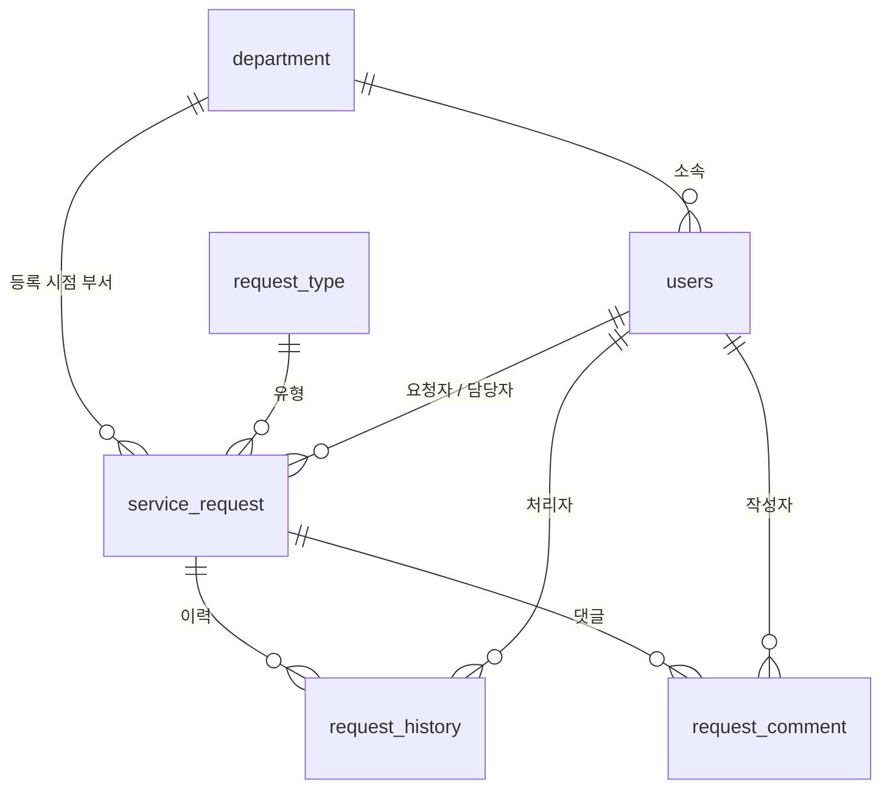

# 업무요청 관리 시스템 테이블 설계

Nov 9, 2026 · @Jaewan

## 설계 원칙

[기획·화면설계](01-기획-화면설계.md)에서 정한 규칙을 테이블로 옮겼습니다. 테이블은 6개이고, 국내 Spring·MySQL 실무에서 가장 흔한 방식을 기본으로 삼았습니다.

| 항목 | 결정 | 이유 |
| --- | --- | --- |
| 이름 | 테이블·컬럼은 영어 snake\_case, 테이블은 단수형. 요청 테이블은 `service_request` | `request`는 Java 코드에서 HttpServletRequest 등과 헷갈려서 |
| 기본 키 | 모든 테이블 `id BIGINT AUTO_INCREMENT`. 요청 번호(#1019)는 `service_request.id`를 그대로 사용 | JPA `IDENTITY` 전략과 가장 잘 맞고 단순해서. 대신 JDBC 배치 INSERT는 쓰지 못함 |
| 코드값 | 역할·상태·이벤트는 `VARCHAR`에 영문 코드로 저장. JPA는 `@Enumerated(EnumType.STRING)` + `@JdbcTypeCode(SqlTypes.VARCHAR)` | 값을 추가하거나 순서를 바꿔도 기존 데이터가 깨지지 않게. 최신 Hibernate의 MySQL 방언은 enum을 MySQL `ENUM` 타입으로 기대해서 VARCHAR로 명시 |
| 요청 유형 | 별도 테이블(`request_type`)로 관리. 승인 필요 여부는 요청 등록 때 `service_request`에도 복사 | 유형 설정을 바꿔도 이미 등록된 요청의 열람 제한·수정 규칙이 소급해서 바뀌지 않게 |
| 시간 | `DATETIME`, 한국 시간 기준. 앱·MySQL 두 컨테이너 모두 `TZ=Asia/Seoul`(MySQL은 `--default-time-zone=+09:00` 추가). '오늘'은 Java `LocalDate.now()`로 구해 쿼리에 넘기고, SQL에서 `CURDATE()`·`NOW()`를 쓰지 않음. 희망 완료일만 `DATE` | 기획서의 '시간대 통일' 결정. MySQL 공식 이미지는 기본이 UTC라 자정\~오전 9시에 날짜가 어긋날 수 있어서 |
| 공통 시각 컬럼 | `BaseTimeEntity`(created\_at)와 이를 상속한 `BaseEntity`(updated\_at 추가) 두 단계. 요청·댓글·사용자는 BaseEntity, 부서·이력은 BaseTimeEntity, 유형은 상속하지 않음. JPA Auditing으로 자동 기록 | 테이블마다 필요한 시각 컬럼이 달라서 |
| 스키마 관리 | Flyway로 관리(V1 스키마, V2 초기 데이터). JPA는 `ddl-auto=validate`만 | 재시작·재배포해도 한 번만 적용되고 변경 이력이 남아서 |
| 매핑 주의 | `TEXT` 컬럼은 `@Column(columnDefinition = "TEXT")` | validate 단계의 타입 불일치로 앱이 시작되지 않는 일을 막으려고 |
| 목록 정렬 | 모든 목록은 `ORDER BY id DESC` | id 순서가 등록 순서와 같아서. PK 역순 스캔이 가능한 목록은 filesort가 없고, 탭 조건 목록(대기 탭·나에게 배정됨)은 결과가 수백 건이라 작은 filesort를 허용. 전체 탭의 상태·기간 필터는 성능 측정 단계에서 확인 |
| 외래 키 | FK 제약을 둠. 삭제가 없으므로 CASCADE는 쓰지 않음 | 데이터 정합성을 DB에서도 보장 |
| 삭제 | 지우지 않음. 사용자는 `enabled=false`로 비활성화, 댓글은 `deleted=true` | FK와 감사 기록을 보존하려고 |
| 문자셋 | `utf8mb4`, `utf8mb4_0900_ai_ci`, 엔진 InnoDB. 로그인 아이디만 `utf8mb4_bin` | MySQL 8 기본값. 기본 콜레이션은 대소문자를 구분하지 않아 아이디만 구분하게 |
| 동시성 | `service_request.version` 컬럼(`@Version`) | 기획서의 '버전 비교 후 409' 결정 |

## ERD



요청(service\_request)이 유형·요청자·담당자·부서를 가리키고, 이력과 댓글이 요청을 가리킵니다. 이력·댓글의 사람 컬럼(actor\_id, writer\_id 등)도 users를 가리키지만 그림에서는 선을 생략했습니다.

## 테이블 정의

요청 한 건은 `service_request` 한 행이고, 그 요청에 일어난 일은 `request_history`에, 대화는 `request_comment`에 쌓입니다. 나머지 세 테이블은 초기 데이터로 넣는 기준 정보입니다.

### department (부서)

| 컬럼 | 타입 | NULL | 설명 |
| --- | --- | --- | --- |
| id | BIGINT | N | PK |
| name | VARCHAR(50) | N | 부서명, 중복 불가 (교무팀, 원무과 등) |
| created\_at | DATETIME | N | 생성 시각 |

### users (사용자)

| 컬럼 | 타입 | NULL | 설명 |
| --- | --- | --- | --- |
| id | BIGINT | N | PK |
| login\_id | VARCHAR(50) | N | 로그인 아이디, 중복 불가, 대소문자 구분(`utf8mb4_bin`) |
| password | VARCHAR(100) | N | BCrypt 해시 (60자, 알고리즘 변경 여유를 두고 100) |
| name | VARCHAR(50) | N | 이름 |
| role | VARCHAR(20) | N | 역할 코드 (코드값 참고) |
| department\_id | BIGINT | N | FK → department.id, 현재 소속 부서 |
| extension | VARCHAR(20) | Y | 내선번호 |
| enabled | BOOLEAN | N | 사용 여부, 기본 true. false면 로그인 차단, 배정 대상에서 제외 (퇴사·휴직) |
| created\_at | DATETIME | N | 생성 시각 |
| updated\_at | DATETIME | N | 수정 시각 |

`user`는 일부 DB에서 예약어라 복수형 `users`를 씁니다. 담당자·관리자도 부서가 필요하므로 초기 데이터에 '전산팀' 부서를 넣습니다. `enabled`는 관리 화면 없이 SQL로만 바꾸고, Spring Security의 `UserDetails.isEnabled()`와 배정 대상 조건(`role = 'ASSIGNEE' AND enabled`)에 씁니다.

### request\_type (요청 유형)

| 컬럼 | 타입 | NULL | 설명 |
| --- | --- | --- | --- |
| id | BIGINT | N | PK |
| code | VARCHAR(30) | N | 유형 코드, 중복 불가 (PROGRAM\_CHANGE, ACCESS, INCIDENT, DATA\_EXTRACT) |
| name | VARCHAR(50) | N | 화면 표시명 (프로그램 수정 등) |
| approval\_required | BOOLEAN | N | 관리자 승인 필요 여부. 데이터 추출만 true |
| sort\_order | INT | N | 화면 표시 순서 |

### service\_request (요청)

| 컬럼 | 타입 | NULL | 설명 |
| --- | --- | --- | --- |
| id | BIGINT | N | PK, 화면의 요청 번호 |
| type\_id | BIGINT | N | FK → request\_type.id. 등록 후 변경 불가 |
| approval\_required | BOOLEAN | N | 등록 시점의 승인 필요 여부. 유형 설정이 바뀌어도 그대로 |
| requester\_id | BIGINT | N | FK → users.id, 요청자 |
| department\_id | BIGINT | N | FK → department.id, 등록 시점의 요청자 부서 (부서 이동과 무관하게 고정) |
| assignee\_id | BIGINT | Y | FK → users.id, 현재 담당자. 배정 전에는 NULL |
| title | VARCHAR(200) | N | 제목 (검색 대상) |
| content | TEXT | N | 내용. 승인 필요 요청은 열람 권한 확인 대상 |
| due\_date | DATE | N | 희망 완료일 |
| status | VARCHAR(20) | N | 현재 상태 코드 |
| segment\_started\_at | DATETIME | Y | 현재 처리 구간 시작 시각. 처리 중일 때만 값이 있음 |
| processing\_minutes | INT | N | 누적 처리 분, 기본 0. 구간마다 분 단위로 내림해 더함 |
| last\_completed\_at | DATETIME | Y | 최종 완료 시각. 재요청 후에도 지우지 않음 |
| version | BIGINT | N | 낙관적 락 버전 (`@Version`), 기본 0 |
| created\_at | DATETIME | N | 등록 시각 |
| updated\_at | DATETIME | N | 수정 시각 |

처리 결과는 이 테이블에 두지 않고, 가장 최근 COMPLETED 이력의 `content`에서 읽습니다.

### request\_history (처리 이력)

| 컬럼 | 타입 | NULL | 설명 |
| --- | --- | --- | --- |
| id | BIGINT | N | PK |
| request\_id | BIGINT | N | FK → service\_request.id |
| event\_type | VARCHAR(30) | N | 이벤트 종류 코드 |
| from\_status | VARCHAR(20) | Y | 이전 상태. 수정·재배정처럼 상태가 그대로면 이후 상태와 같음. 등록(CREATED)만 NULL |
| to\_status | VARCHAR(20) | N | 이후 상태 |
| from\_assignee\_id | BIGINT | Y | FK → users.id, 이전 담당자 (배정 이벤트만) |
| to\_assignee\_id | BIGINT | Y | FK → users.id, 이후 담당자 (배정 이벤트만) |
| content | VARCHAR(1000) | Y | 사유, 처리 결과, 또는 수정된 항목명 (예: "제목, 내용") |
| actor\_id | BIGINT | N | FK → users.id, 처리한 사람 |
| created\_at | DATETIME | N | 발생 시각 |

이력은 추가만 하고 수정·삭제하지 않습니다.

### request\_comment (댓글)

| 컬럼 | 타입 | NULL | 설명 |
| --- | --- | --- | --- |
| id | BIGINT | N | PK |
| request\_id | BIGINT | N | FK → service\_request.id |
| writer\_id | BIGINT | N | FK → users.id, 작성자 |
| content | VARCHAR(2000) | N | 댓글 내용 |
| deleted | BOOLEAN | N | 삭제 여부, 기본 false. 삭제하면 화면에 '삭제된 댓글입니다' |
| created\_at | DATETIME | N | 작성 시각 |
| updated\_at | DATETIME | N | 수정 시각 (삭제 시각 포함) |

## 코드값

코드는 Java enum 이름과 같고, 화면 표시명은 enum에 함께 둡니다.

### 역할 (users.role)

| 코드 | 표시명 |
| --- | --- |
| REQUESTER | 요청자 |
| ASSIGNEE | 담당자 |
| ADMIN | 관리자 |

### 요청 상태 (service\_request.status)

| 코드 | 표시명 | 끝난 상태 |
| --- | --- | --- |
| PENDING\_APPROVAL | 승인 대기 |  |
| RECEIVED | 접수 대기 |  |
| ASSIGNED | 배정됨 |  |
| IN\_PROGRESS | 처리 중 |  |
| ON\_HOLD | 보류 |  |
| COMPLETED | 완료 | 재요청 시 다시 열림 |
| REJECTED | 반려 | 예 |
| CANCELED | 취소 | 예 |

### 이력 이벤트 (request\_history.event\_type)

| 코드 | 누가 | 상태 변화 | content |
| --- | --- | --- | --- |
| CREATED | 요청자 | → 승인 대기 또는 접수 대기 |  |
| UPDATED | 요청자 | 승인 대기·접수 대기에서만 (승인 필요 요청은 승인 대기에서만), 상태 그대로 | 수정된 항목명 |
| APPROVED | 관리자 | 승인 대기 → 접수 대기 |  |
| REJECTED | 관리자 | 승인 대기·접수 대기 → 반려 | 사유 (필수) |
| ASSIGNED | 관리자 | 접수 대기 → 배정됨 (최초), 재배정은 배정됨·처리 중·보류에서만, 상태 그대로. 대상은 enabled인 담당자만 |  |
| STARTED | 배정된 담당자 | 배정됨 → 처리 중 |  |
| HELD | 배정된 담당자 | 처리 중 → 보류 | 사유 (필수) |
| RESUMED | 배정된 담당자 | 보류 → 처리 중 |  |
| COMPLETED | 배정된 담당자 | 처리 중 → 완료 | 처리 결과 (필수) |
| REOPENED | 요청자 | 완료 → 처리 중 (최종 완료 7일 이내) | 사유 (필수) |
| CANCELED | 요청자 | 승인 대기·접수 대기·배정됨 → 취소 |  |

최초 배정과 재배정은 같은 ASSIGNED이고, `from_assignee_id`가 NULL이면 최초 배정입니다. 이 표가 공식 상태 전이 규칙이며, 도메인 코드의 검사도 이 표를 그대로 따릅니다.

## 상태 변경 시 갱신 규칙

모든 이벤트는 한 트랜잭션 안에서 `service_request`를 갱신하고 `request_history`에 한 행을 추가합니다. `version`과 `updated_at`은 JPA가 자동으로 바꿉니다.

| 이벤트 | service\_request에서 바뀌는 컬럼 |
| --- | --- |
| CREATED | status = PENDING\_APPROVAL(승인 필요 유형) 또는 RECEIVED, department\_id = 요청자의 현재 부서, approval\_required = 유형의 현재 값 |
| UPDATED | title, content, due\_date 중 바뀐 것 |
| APPROVED | status = RECEIVED |
| REJECTED | status = REJECTED |
| ASSIGNED | assignee\_id = 새 담당자. 최초 배정이면 status = ASSIGNED |
| STARTED | status = IN\_PROGRESS, segment\_started\_at = 지금 |
| HELD | status = ON\_HOLD, processing\_minutes += (지금 − segment\_started\_at), segment\_started\_at = NULL |
| RESUMED | status = IN\_PROGRESS, segment\_started\_at = 지금 |
| COMPLETED | status = COMPLETED, processing\_minutes += (지금 − segment\_started\_at), segment\_started\_at = NULL, last\_completed\_at = 지금 |
| REOPENED | status = IN\_PROGRESS, segment\_started\_at = 지금 (last\_completed\_at은 그대로) |
| CANCELED | status = CANCELED |

구간 시간은 Java에서 `Duration.between(...).toMinutes()`로 계산해 분 단위로 내림합니다. 이 계산은 서비스가 아니라 `ServiceRequest` 엔티티의 메서드(`start()`, `hold()`, `complete()` 등) 안에 두어, 상태 전이 규칙과 시간 갱신이 한 곳에서 함께 검사되게 합니다.

## 인덱스 초안과 성능 측정 계획

처음에는 PK·UNIQUE·FK 인덱스만 두고 시작합니다. 나머지는 10만 건으로 측정한 뒤 추가해, 개선 전후를 성능 개선 기록에 남깁니다. InnoDB는 FK 컬럼에 인덱스가 없으면 자동으로 만듭니다.

| 인덱스 | 컬럼 | 쓰이는 곳 | 시점 |
| --- | --- | --- | --- |
| uk\_users\_login\_id | users(login\_id) | 로그인 | 처음부터 |
| uk\_department\_name, uk\_request\_type\_code | 각 테이블의 이름·코드 | 중복 방지 | 처음부터 |
| FK 자동 인덱스 | request\_id, requester\_id, assignee\_id 등 | 상세의 이력·댓글 조회, 내 요청 | 처음부터 |
| idx\_request\_status\_created | service\_request(status, created\_at) | 탭 건수, 측정 쿼리 ①의 COUNT | 측정 후 |
| idx\_request\_status\_due | service\_request(status, due\_date) | 지연 집계, 측정 쿼리 ② | 측정 후 |
| idx\_request\_assignee\_status | service\_request(assignee\_id, status) | 나에게 배정됨, 담당자별 처리 중 건수 | 측정 후 |
| idx\_request\_status\_completed | service\_request(status, last\_completed\_at) | 유형별 평균 처리 시간 | 측정 후 |

이력·댓글은 `id` 순서가 시간 순서와 같아서, FK 인덱스(request\_id)와 `ORDER BY id`만으로 충분합니다. 표의 '쓰이는 곳'은 설계 의도입니다. 실측에서는 옵티마이저가 status로 시작하는 다른 인덱스를 고르기도 했습니다(탭 건수·대기 탭 → idx\_request\_status\_due, 담당자별 처리 중 건수 → idx\_request\_status\_created). 이 인덱스 셋이 서로 대신할 수 있는지는 성능 측정 단계에서 정리합니다.

**측정 순서**

1. 테스트용 요청 10만 건과 이력을 스크립트로 넣습니다 (기획서의 분포: 최근 2년, 부서 20개, 완료 위주).
2. 측정 쿼리 ① 상태·기간 필터 + 등록 역순(id DESC) 20건 목록과 COUNT, ② 현재 지연 집계(status IN 미완료 5개 AND due\_date < 오늘 파라미터, NOT IN은 쓰지 않음)를 EXPLAIN으로 확인하고 10회 평균 시간을 기록합니다.
3. 위 표의 '측정 후' 인덱스를 추가하고 같은 측정을 반복합니다.
4. type(접근 방식), rows(검사 행 수), Extra(filesort 여부)의 변화를 README에 표로 남깁니다. 검색어 LIKE '%…%'는 일반 인덱스로 해결되지 않는다는 점도 함께 기록합니다.

컬럼 순서는 측정 결과에 따라 바뀔 수 있고, 바뀐 이유도 기록 대상입니다.

## DDL (MySQL 8)

이 스크립트는 Flyway의 `V1__init.sql`로 둡니다. 부서('전산팀' 포함)·사용자·요청 유형 초기 데이터는 `V2__seed.sql`에 넣고, '측정 후' 인덱스는 성능 측정 단계에서 `V3` 이후 마이그레이션으로 추가해 변경 이력이 남게 합니다.

```sql
CREATE TABLE department (
  id         BIGINT      NOT NULL AUTO_INCREMENT,
  name       VARCHAR(50) NOT NULL,
  created_at DATETIME    NOT NULL DEFAULT CURRENT_TIMESTAMP,
  PRIMARY KEY (id),
  UNIQUE KEY uk_department_name (name)
) ENGINE=InnoDB DEFAULT CHARSET=utf8mb4 COLLATE=utf8mb4_0900_ai_ci;

CREATE TABLE users (
  id            BIGINT       NOT NULL AUTO_INCREMENT,
  login_id      VARCHAR(50)  COLLATE utf8mb4_bin NOT NULL,
  password      VARCHAR(100) NOT NULL,
  name          VARCHAR(50)  NOT NULL,
  role          VARCHAR(20)  NOT NULL,
  department_id BIGINT       NOT NULL,
  extension     VARCHAR(20)  NULL,
  enabled       BOOLEAN      NOT NULL DEFAULT TRUE,
  created_at    DATETIME     NOT NULL DEFAULT CURRENT_TIMESTAMP,
  updated_at    DATETIME     NOT NULL DEFAULT CURRENT_TIMESTAMP,
  PRIMARY KEY (id),
  UNIQUE KEY uk_users_login_id (login_id),
  CONSTRAINT fk_users_department FOREIGN KEY (department_id) REFERENCES department (id)
) ENGINE=InnoDB DEFAULT CHARSET=utf8mb4 COLLATE=utf8mb4_0900_ai_ci;

CREATE TABLE request_type (
  id                BIGINT      NOT NULL AUTO_INCREMENT,
  code              VARCHAR(30) NOT NULL,
  name              VARCHAR(50) NOT NULL,
  approval_required BOOLEAN     NOT NULL DEFAULT FALSE,
  sort_order        INT         NOT NULL,
  PRIMARY KEY (id),
  UNIQUE KEY uk_request_type_code (code)
) ENGINE=InnoDB DEFAULT CHARSET=utf8mb4 COLLATE=utf8mb4_0900_ai_ci;

CREATE TABLE service_request (
  id                 BIGINT       NOT NULL AUTO_INCREMENT,
  type_id            BIGINT       NOT NULL,
  approval_required  BOOLEAN      NOT NULL,
  requester_id       BIGINT       NOT NULL,
  department_id      BIGINT       NOT NULL,
  assignee_id        BIGINT       NULL,
  title              VARCHAR(200) NOT NULL,
  content            TEXT         NOT NULL,
  due_date           DATE         NOT NULL,
  status             VARCHAR(20)  NOT NULL,
  segment_started_at DATETIME     NULL,
  processing_minutes INT          NOT NULL DEFAULT 0,
  last_completed_at  DATETIME     NULL,
  version            BIGINT       NOT NULL DEFAULT 0,
  created_at         DATETIME     NOT NULL,
  updated_at         DATETIME     NOT NULL,
  PRIMARY KEY (id),
  CONSTRAINT fk_request_type       FOREIGN KEY (type_id)       REFERENCES request_type (id),
  CONSTRAINT fk_request_requester  FOREIGN KEY (requester_id)  REFERENCES users (id),
  CONSTRAINT fk_request_department FOREIGN KEY (department_id) REFERENCES department (id),
  CONSTRAINT fk_request_assignee   FOREIGN KEY (assignee_id)   REFERENCES users (id)
) ENGINE=InnoDB DEFAULT CHARSET=utf8mb4 COLLATE=utf8mb4_0900_ai_ci;

CREATE TABLE request_history (
  id               BIGINT        NOT NULL AUTO_INCREMENT,
  request_id       BIGINT        NOT NULL,
  event_type       VARCHAR(30)   NOT NULL,
  from_status      VARCHAR(20)   NULL,
  to_status        VARCHAR(20)   NOT NULL,
  from_assignee_id BIGINT        NULL,
  to_assignee_id   BIGINT        NULL,
  content          VARCHAR(1000) NULL,
  actor_id         BIGINT        NOT NULL,
  created_at       DATETIME      NOT NULL,
  PRIMARY KEY (id),
  CONSTRAINT fk_history_request       FOREIGN KEY (request_id)       REFERENCES service_request (id),
  CONSTRAINT fk_history_from_assignee FOREIGN KEY (from_assignee_id) REFERENCES users (id),
  CONSTRAINT fk_history_to_assignee   FOREIGN KEY (to_assignee_id)   REFERENCES users (id),
  CONSTRAINT fk_history_actor         FOREIGN KEY (actor_id)         REFERENCES users (id)
) ENGINE=InnoDB DEFAULT CHARSET=utf8mb4 COLLATE=utf8mb4_0900_ai_ci;

CREATE TABLE request_comment (
  id         BIGINT        NOT NULL AUTO_INCREMENT,
  request_id BIGINT        NOT NULL,
  writer_id  BIGINT        NOT NULL,
  content    VARCHAR(2000) NOT NULL,
  deleted    BOOLEAN       NOT NULL DEFAULT FALSE,
  created_at DATETIME      NOT NULL,
  updated_at DATETIME      NOT NULL,
  PRIMARY KEY (id),
  CONSTRAINT fk_comment_request FOREIGN KEY (request_id) REFERENCES service_request (id),
  CONSTRAINT fk_comment_writer  FOREIGN KEY (writer_id)  REFERENCES users (id)
) ENGINE=InnoDB DEFAULT CHARSET=utf8mb4 COLLATE=utf8mb4_0900_ai_ci;
```

초기 데이터를 SQL로 넣는 부서·사용자 테이블에만 시각 기본값을 둡니다. 앱이 넣는 테이블은 JPA Auditing이 값을 채웁니다. JPA는 `spring.jpa.hibernate.ddl-auto=validate`로 두어, 엔티티와 이 스크립트가 다르면 앱이 시작되지 않게 합니다. 시간대 처리는 설계 원칙의 '시간' 항목을 따릅니다.

## 검증 결과 (MySQL 8.0.46, 8.4에서 실행)

위 DDL을 그대로 실행하고 요청 10만 건·이력 19만 건을 넣어, 기획서 항목을 쿼리로 확인했습니다. 판정한 12개는 모두 통과했고, 집계 4개(T05·T07·T08·T11)는 값을 출력해 확인했습니다. 데이터는 최근 2년, 부서 20개, 완료 92%로 만들었고 '오늘'은 2026-11-10으로 고정했습니다.

목표 버전은 MySQL 8.4 LTS입니다. 8.0은 2026년 4월에 지원이 끝났기 때문입니다. 설계 단계에서는 작업 환경에서 8.4를 받을 수 없어 8.0.46에서 검증했고, 프로젝트 세팅 때(2026-11-10) `mysql:8.4` 컨테이너에서 같은 검증 SQL을 다시 실행해 아래 표와 같은 결과를 확인했습니다. 아래의 인덱스 전후 실행 계획(EXPLAIN)은 8.0.46 측정값이며, 8.4에서는 성능 측정 단계에서 다시 확인합니다.

| 번호 | 기획서 항목 | 확인 방법 | 결과 |
| --- | --- | --- | --- |
| T00 | DDL이 MySQL 8에서 실행됨 | V1 스크립트 그대로 실행 | 통과 |
| T01 | 시간대 한국 시간 통일 | 서버 time\_zone = +09:00 | 통과 |
| T02 | 로그인 아이디 대소문자 구분 | admin과 Admin 동시 등록 | 통과 |
| T03 | 사용자·요청은 지우지 않음 | 이력이 있는 사용자를 삭제하면 FK 오류(1451) | 통과 |
| T04 | 요청자는 내 요청만 | requester\_id + id 역순 20건 | 통과 |
| T05 | 탭 건수는 탭 조건으로만 | 승인 대기 38 / 접수 대기 649 | 값 확인 |
| T06 | 나에게 배정됨은 배정됨·처리 중·보류만 | assignee\_id + status IN 3개 | 통과 |
| T07 | 지연 = 희망 완료일 < 오늘, 미완료만 | status IN 5개 + due\_date < 파라미터 → 1,309건 | 값 확인 |
| T08 | 유형별 평균 처리 시간 | 상태 COMPLETED + last\_completed\_at 기간 + GROUP BY 유형 → 10월 기준 PROGRAM\_CHANGE 2,156 / ACCESS 2,188 / INCIDENT 2,113 / DATA\_EXTRACT 2,098분 | 값 확인 |
| T09 | 배정 드롭다운: 활성 담당자 + 처리 중 건수 | 비활성(퇴사) 담당자 제외, 5명의 건수 표시 | 통과 |
| T10 | 상세의 처리 결과 | 가장 최근 COMPLETED 이력의 content | 통과 |
| T11 | 재요청·댓글 7일 규칙 | last\_completed\_at 기준 7일 이내 건 조회 → 630건 | 값 확인 |
| T12 | 승인 필요 여부는 등록 시점 값 | 유형 설정을 바꿔도 기존 요청 값 유지 | 통과 |
| T13 | 처리 시간에서 보류 기간 제외 | 시작 → 30분 후 보류 → 3.5시간 후 재개 → 45분 후 완료 = 75분 | 통과 |
| T14 | 재요청 후 최종 완료 시각 유지, 통계에서 제외 | 재요청 후 last\_completed\_at 그대로, COMPLETED 집계에서 빠짐 | 통과 |
| T15 | 코드값 길이 | 가장 긴 상태·이벤트 코드가 컬럼 길이 안 | 통과 |

**인덱스 전후 실행 계획 (EXPLAIN)**

| 쿼리 | 인덱스 전 | 인덱스 후 |
| --- | --- | --- |
| ① 목록 COUNT (상태 + 기간) | 전체 스캔(100,000행), 31.5ms | idx\_request\_status\_created 범위 스캔(7,281행), 인덱스만으로 처리, 3.7ms |
| ② 지연 집계 | 전체 스캔(100,000행), 27ms | idx\_request\_status\_due 범위 스캔(1,309행), 인덱스만으로 처리, 1.2ms |
| ① 목록 20건 (상태 + 기간, id 역순) | PK 역순 스캔, 0.05ms | PK 역순 스캔(48행), 0.05ms |
| 대기 탭 (status = RECEIVED, id 역순) | PK 역순 스캔, 0.13ms | idx\_request\_status\_due + 649행 filesort, 0.25ms |
| 나에게 배정됨 | FK 인덱스 역순 스캔, 0.32ms | idx\_request\_assignee\_status + 213행 filesort, 0.28ms |
| 내 요청 | FK 인덱스 역순 스캔, 0.04ms | 같음, 0.06ms |
| 전체 탭 (기간만, id 역순) | PK 역순 스캔, 0.03ms | skip scan + filesort(약 33,000행 예상), 2.8ms. PK를 강제하면 0.03ms |

시간은 MySQL `EXPLAIN ANALYZE`의 실측값(actual time)입니다. 행 수는 실제로 읽은 행(actual rows)이고, '예상'이라고 쓴 값만 옵티마이저 추정입니다. 한 번씩 잰 예비 측정이고, 성능 측정 단계에서 10회 평균으로 다시 쟽니다.

실행하면서 새로 알게 된 점이 세 가지 있습니다. 둘 다 성능 개선 기록에 그대로 남길 소재입니다.

- **인덱스가 큰 효과를 낸 곳은 건수·집계 쿼리입니다(약 9\~22배).** 최근 기간의 목록 20건 조회는 처음부터 1ms 안쪽이었습니다. 기간이 최근이라 PK 역순 스캔 앞쪽에서 20건이 바로 차기 때문입니다. 반대로 과거 기간(완료 + 2025년 3월) 목록은 인덱스를 추가해도 옵티마이저가 PK 역순 스캔을 골라 약 8만 행을 읽고 34ms가 걸렸습니다(같은 조건의 COUNT는 2ms). 성능 측정 단계의 개선 대상입니다.
- **인덱스를 추가했더니 '전체' 탭 계획이 오히려 나빠졌습니다(0.03ms → 2.8ms).** 옵티마이저가 skip scan을 고른 탓입니다. 측정 단계에서 데이터를 늘려 다시 확인하고, 필요하면 이 쿼리만 PK 역순 스캔을 쓰도록 고칩니다.
- **(assignee\_id, status) 인덱스를 만들면 MySQL이 FK용 자동 인덱스를 없애고 이 인덱스로 대신합니다.** 그래서 이후에 이 인덱스를 따로 지울 수 없습니다(오류 1553). 마이그레이션을 되돌리는 스크립트를 쓸 때 주의합니다.

## 다음 단계

- [x] 기획서 항목별 추적표 작성, 실제 MySQL 8에서 DDL과 핵심 쿼리 실행 검증
- [x] 이 테이블 설계 확정
- [x] API 목록 정리 (화면·이벤트별 엔드포인트, 권한, 오류 코드)
- [ ] Java 기초 학습 시작 (0주차)
